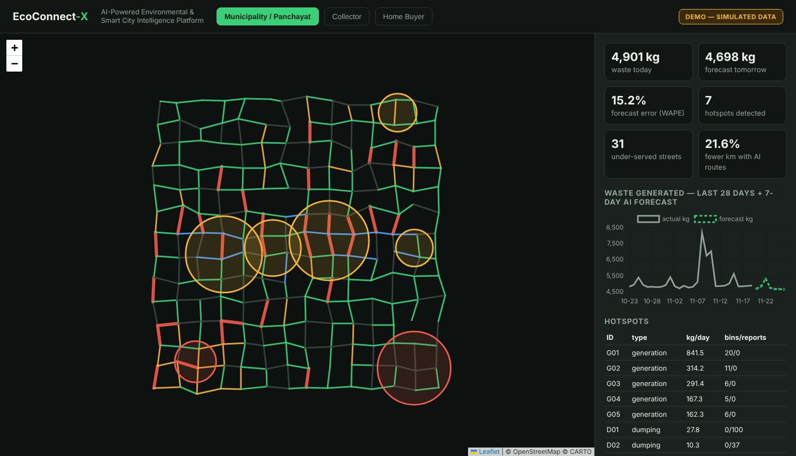
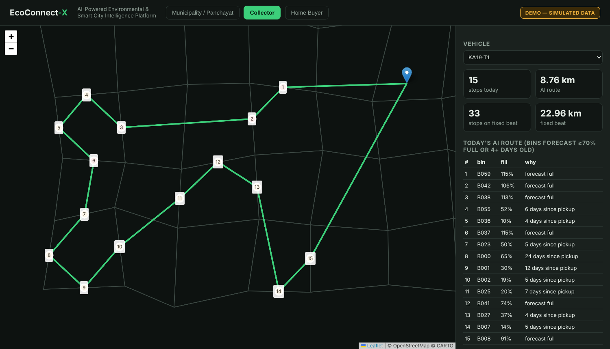
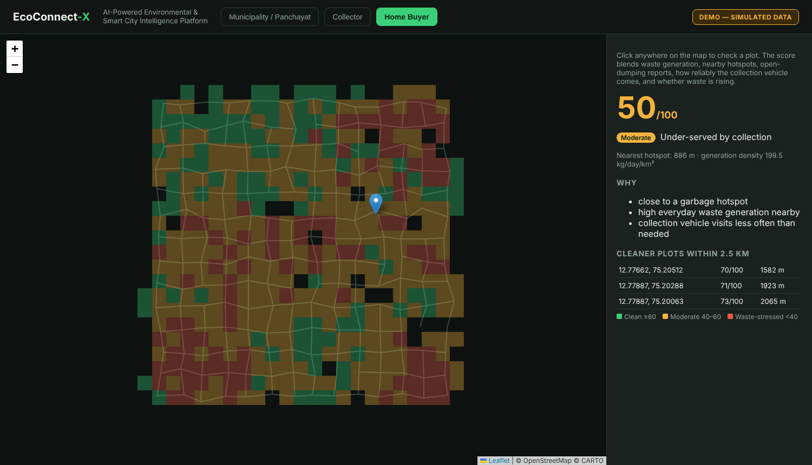

# EcoConnect-X 🌱
## AI-Powered Environmental & Smart City Intelligence Platform

**Intelligent waste management. Sustainable cities. Smarter urban decisions.**

> ⚠️ **DEMO — SIMULATED DATA.** This is a software-only hackathon prototype. Every bin reading, GPS ping and citizen report comes from a Python simulator, not from live IoT sensors.

EcoConnect-X shows **where** garbage is generated, **how much**, **whether the collection vehicle actually goes there**, and **what that means for people choosing where to live.**

Most local bodies don't know which streets produce the most waste, how often each street is really served, or why some areas keep turning into dumping spots. Collection runs on fixed beats that were drawn up years ago. EcoConnect-X combines collection-vehicle GPS, smart-bin fill readings and geo-tagged citizen reports (all simulated in this prototype), and runs ML models over all three to answer:

| Who | Question EcoConnect-X answers | ML used |
|---|---|---|
| **Municipality / Panchayat** | Where is waste generated, and how much will there be next week? | Gradient-boosted forecasting + weighted DBSCAN hotspots |
| **Municipality / Panchayat** | Which streets does the vehicle actually drive, how often, and is that enough? | GPS map-matching + required-frequency model |
| **Municipality / Panchayat** | Which trips look wrong (beat skipped, long idling)? | IsolationForest anomaly detection |
| **Garbage collectors** | Which bins should I visit today, in what order? | Forecast-driven routing (nearest neighbour + 2-opt) |
| **Home buyers / planners** | How clean is the area around this plot, and where is cleaner? | Explainable Waste Livability Score + KMeans area archetypes |

---

## Results on the simulated town (Puttur, 5 × 5 km, 180 days)

| Metric | Value |
|---|---|
| Forecast error (MAE per bin per day) | **3.28 kg**, vs 5.16 kg for the "same as yesterday" baseline (**36% better**) |
| Forecast WAPE | 15.2% |
| Hotspots found | 5 generation hotspots + 2 illegal-dumping hotspots |
| Under-served streets flagged from GPS | 31 (including the outskirt beat one crew keeps skipping) |
| Anomalous trips flagged | 7 of 84 vehicle-days |
| **AI routing vs fixed beat (21-day backtest)** | **21.6% fewer km · 31% fewer bin visits · 96% fewer overflow bin-days** |

All numbers come from `outputs/summary.json` and are reproduced by running the pipeline.
The data is synthetic (see [Data](#data)), with real-world problems deliberately built in so we can check that the models find them.

## Screenshots

| Municipality / Panchayat | Collector | Home buyer |
|---|---|---|
|  |  |  |

---

## How it works

```
 Simulated vehicle GPS     Simulated bin weights          Citizen reports (photo + GPS)
 (replaces ESP32+NEO-6M)   (replaces ESP32+HX711+cell)    open-dumping reports
        │                          │                              │
        └──────────────┬───────────┴──────────────┬──────────────┘
                       ▼                          ▼
              Flask REST API  (/api/ingest/gps, /api/ingest/bin, /api/report)
                       │
                       ▼
     ┌──────────────────── ecoconnect ML pipeline ────────────────────┐
     │ 1. forecast.py    per-bin 7-day waste forecast (HistGBR)     │
     │ 2. hotspots.py    density grid + weighted DBSCAN hotspots    │
     │ 3. coverage.py    GPS map-matching → visits/week per street  │
     │                   vs ML-required frequency; IsolationForest  │
     │ 4. routing.py     forecast-driven daily routes + backtest    │
     │ 5. livability.py  Waste Livability Score + KMeans archetypes │
     └──────────────────────────────────────────────────────────────┘
                       │  outputs/*.csv, *.json
                       ▼
     Leaflet + Chart.js dashboard: Municipality · Collector · Home buyer
```

### 1. Waste forecasting (`ecoconnect/forecast.py`)
`HistGradientBoostingRegressor` trained on lag features (1, 2, 3, 7, 14 days), 7- and 28-day rolling means, trend ratio, weekday, festival calendar (Ganesh Chaturthi, Dasara, Deepavali), rainfall and land use. It is tested on a strict time split (last 21 days) against two baselines. Forecasts are made recursively 7 days ahead.

### 2. Where garbage is generated (`ecoconnect/hotspots.py`)
* **Density grid**: kg/day/km² for every ~250 m cell.
* **Generation hotspots**: DBSCAN with the haversine metric, where each bin is weighted by its kg/day. A cluster needs ≥150 kg/day within 350 m.
* **Dumping hotspots**: DBSCAN over 90 days of citizen reports. A cluster needs ≥25 reports within 300 m.

### 3. Which streets the vehicle actually serves (`ecoconnect/coverage.py`)
* Each GPS ping is **map-matched** to the nearest street segment (BallTree, haversine, 35 m gate).
* A street counts as *served* only when the vehicle **stops** on it. Just driving through doesn't count.
* The required frequency comes from the forecast (weekly kg ÷ 85% of bin capacity), with a hygiene floor of at least one pickup every 4 days.
* Each street is then labelled **under-served / watch / ok / over-served**. This gives the panchayat an objective view of how often each street is really covered.
* **IsolationForest** looks at per-trip features (km, hours, stops, idle minutes, streets covered), normalised against each vehicle's own usual pattern. It flags short trips, skipped beats and excessive idling.

### 4. Collector routing (`ecoconnect/routing.py`)
Each morning, a bin goes on the route if its current reading plus tomorrow's forecast is ≥70% of capacity, or if it hasn't been emptied for 4+ days. Each vehicle's stops are ordered with nearest-neighbour + 2-opt. `backtest_policy()` replays the last 21 days using only out-of-sample forecasts and compares km driven, visits and overflow with what the fixed schedule actually did.

### 5. Waste Livability Score for home buyers (`ecoconnect/livability.py`)
Each cell gets a score from 0 to 100 that combines five explainable signals:

| Signal | Weight |
|---|---|
| Waste generation density | 0.30 |
| Distance to nearest hotspot | 0.20 |
| Open-dumping reports | 0.20 |
| Collection reliability (served ÷ required visits) | 0.15 |
| Growth trend (forecast vs recent, recent vs 6 months ago) | 0.15 |

Each lookup returns the score, a zone (Clean / Moderate / Waste-stressed), the **top reasons** behind it, and up to 3 **cleaner plots within 2.5 km**. KMeans (k = 5) on the risk profile groups the town into archetypes such as *Fast-growing layout*, *Dumping-prone area* and *Under-served by collection*.

---

## Quick start

```bash
git clone https://github.com/shamith-u-nirmal/EcoConnect-X.git
cd EcoConnect-X
python -m venv venv && source venv/bin/activate      # Windows: venv\Scripts\activate
pip install -r requirements.txt

python -m ecoconnect.simulate      # generate the synthetic town   (~4 s)
python -m ecoconnect.pipeline      # train + run all ML models     (~3 s)
python app/app.py               # dashboard on http://localhost:5000
pytest -q                       # 6 end-to-end tests
```

The dashboard bundles Leaflet and Chart.js, so it works on poor connectivity. Only the map background tiles need internet.

## API

| Method | Endpoint | Purpose |
|---|---|---|
| GET | `/api/summary` | KPIs and model metrics |
| GET | `/api/hotspots` | Generation and dumping hotspots |
| GET | `/api/density` | kg/day/km² grid |
| GET | `/api/streets?status=under-served` | Per-street service vs requirement |
| GET | `/api/trips?anomalies=1` | Flagged vehicle trips |
| GET | `/api/route?vehicle=KA19-T1` | Today's AI route |
| GET | `/api/forecast?bin_id=B012` | 28-day history + 7-day forecast (town total if no bin) |
| GET | `/api/livability?lat=12.76&lon=75.20` | Score, reasons and cleaner alternatives for a plot |
| POST | `/api/ingest/gps` | Vehicle tracker pings `{vehicle_id, lat, lon, speed_kmph}` (single or list) |
| POST | `/api/ingest/bin` | Smart-bin reading `{bin_id, weight_kg}` |
| POST | `/api/report` | Citizen dumping report `{lat, lon, category}` |
| POST | `/api/retrain` | Re-run the ML pipeline |

## Software-only: how hardware is simulated
The hackathon build doesn't use any physical hardware. `ecoconnect/simulate.py` stands in for each device:

| Original hardware idea | Software replacement |
|---|---|
| ESP32 + HX711 + load cell in each bin | Synthetic daily bin weights (land use, weekday, festivals, rain, noise) |
| Physical fill sensor | Fill % = weight ÷ bin capacity |
| GPS tracker on each vehicle | Simulated vehicle trips along the street network, with GPS noise |
| Wi-Fi transmission | REST ingest endpoints (`/api/ingest/*`) or direct CSV/database loading |

`firmware/` contains reference ESP32 sketches for a possible future hardware pilot. They aren't part of the hackathon demo.

## Data
`ecoconnect/simulate.py` generates a 14 × 14 street grid centred on Puttur (12.759° N, 75.201° E) with 342 street segments and 244 smart bins, plus 180 days of load-cell readings, 28 days of GPS traces from 3 vehicles (~107k pings) and ~2,400 citizen reports. These problems are built in on purpose:
* a market core and a commercial corridor that produce far more waste;
* a new layout whose waste grows ~90% over six months;
* one crew that skips outskirt streets 80% of the time;
* occasional short trips and long idling;
* festival spikes and monsoon effects.

In a real deployment, streets come from **OpenStreetMap**, and the three data streams come from the devices and the citizen app through the ingest API.

## Project structure
```
ecoconnect/        ML + GIS core (simulate, forecast, hotspots, coverage, routing, livability, pipeline)
app/            Flask API + Leaflet dashboard (vendored JS in app/static/vendor)
firmware/       reference ESP32 sketches (future hardware pilot, not used in the demo)
tests/          end-to-end pytest suite
docs/           screenshots
```

## Roadmap
* Road-network distances (OSRM / OR-Tools VRP with vehicle capacity) in place of haversine × 1.3
* Photo classification of citizen reports (wet / dry / construction debris / burning)
* Kannada and Tulu UI, plus a WhatsApp bot for citizen reports
* Integration with municipal ward boundaries and property-tax GIS layers

## License
MIT. This is the AI/ML extension of the EcoConnect-X platform by Soorya Bhat ([original app](https://github.com/SooryaBhat/Eco_Connect)).
